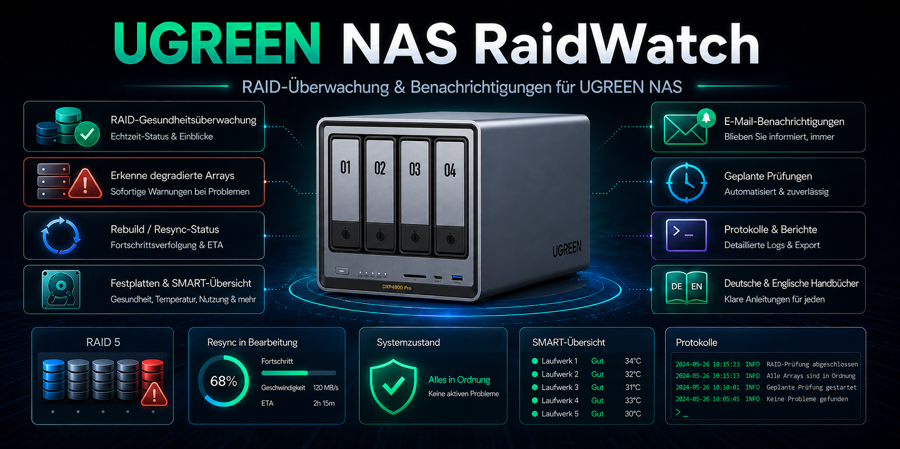

# UGREEN NAS RaidWatch

[](https://github.com/Railsimulatornet/UGREEN-NAS-RaidWatch/actions/workflows/quality.yml)
[](LICENSE)



[Deutsch](#deutsch) · [English](#english)

## Deutsch

RaidWatch überwacht den Storage-Status eines UGREEN NAS mit UGOS Pro. Bei Problemen oder konfigurierten Statusänderungen versendet das Bash-Skript einen Outlook-freundlichen HTML-Report per E-Mail.

### Funktionen

- MD-RAID-Prüfung mit `mdadm`: OK, DEGRADED sowie Rebuild, Resync und Recovery mit verfügbarem Fortschritt, Geschwindigkeit und Restzeit.
- Schachtzuordnung über die RaidDevice-Slots von `mdadm`.
- Optionale Btrfs-Prüfung; ZFS-Prüfung ist vorhanden, unter UGOS standardmäßig deaktiviert.
- HTML- oder Textmail auf Deutsch und Englisch über `REPORT_LANG`.
- Einzellauf für Cron oder Loop mit einstellbarem Intervall.
- Statusspeicherung und Cooldown gegen wiederholte Alarmmails.
- Fehlgeschlagene Alarm-, Änderungs- und Entwarnungsmails werden bei folgenden Prüfläufen erneut versucht.

### Voraussetzungen

- UGREEN NAS mit UGOS Pro.
- Bash und Python 3 für Skript und Mailversand.
- `mdadm` für MD RAID; `btrfs` beziehungsweise `zpool`, wenn der zugehörige Check aktiviert wird.
- Ausreichende Rechte zum Lesen der Storage-Daten und zum Schreiben von Logs und Statusdateien.
- SMTP-Zugang für den Mailversand.

### Schnellstart

1. Lade das aktuelle Paket unter [Releases](https://github.com/Railsimulatornet/UGREEN-NAS-RaidWatch/releases/latest) herunter.
2. Kopiere den **Inhalt** des Ordners `raidwatch/` auf dein NAS, zum Beispiel nach `/volume2/docker/raidwatch/`.
3. Bearbeite dort `raidwatch.env`. Passe insbesondere `NAS_NAME`, Sprache und die SMTP-Platzhalter an.
4. Sende eine Testmail:

```bash
cd /volume2/docker/raidwatch
bash ./raidwatch.sh --test-mail
```

5. Prüfe den Storage-Status einmalig:

```bash
bash ./raidwatch.sh --once
```

Die Pfade sind Beispiele. Verwende das Volume und den Zielordner deiner Installation.

### Konfiguration

Alle Einstellungen stehen in [raidwatch/raidwatch.env](raidwatch/raidwatch.env); auf dem NAS liegt die aktive Datei direkt neben `raidwatch.sh`.

| Bereich | Einstellungen |
| --- | --- |
| NAS und Sprache | `NAS_NAME`, `REPORT_LANG=de` oder `REPORT_LANG=en`, `SUBJECT_PREFIX`. |
| SMTP-Zugang | `SMTP_SERVER`, `SMTP_PORT`, `SMTP_USER`, `SMTP_PASS`, `MAIL_FROM`, `MAIL_TO`. |
| Mailverschlüsselung | `SMTP_STARTTLS=1` und `SMTP_SSL=0` für STARTTLS; `SMTP_STARTTLS=0` und `SMTP_SSL=1` für implizites TLS. Port und `SMTP_TIMEOUT` passend zum Server wählen. |
| Maildarstellung | `MAIL_FORMAT=html` oder `MAIL_FORMAT=text`; `HTML_SHOW_DETAILS` steuert den Detailsblock. |
| Checks | `CHECK_MDRAID=1`, `CHECK_BTRFS=1`, `CHECK_ZFS=0` sind die Vorgaben der Vorlage. |
| Änderungen und Cooldown | `ALERT_ON_CHANGE` aktiviert Mails bei Statusänderungen ohne Fehler. `ALERT_COOLDOWN_SECONDS=3600` begrenzt Wiederholungen bei anhaltenden Problemen. |
| Log und Status | `LOG_DIR` und `STATE_DIR`. Ein leerer Logpfad verwendet `raidwatch-logs/` im Skriptordner; ein leerer Statuspfad folgt dem Logpfad. |
| Aufbewahrung | `LOG_RETENTION_DAYS=30`, `LOG_MAX_MB=5`, `LOG_ROTATE_COUNT=3` und `LOG_NO_CHANGE_RUNS=0`. |
| Loop | `SLEEP_SECONDS=60` ist das Standardintervall in Sekunden. |

Wenn du unnötige HDD-Anläufe vermeiden möchtest, kannst du Logs und Status auf ein geeignetes NVMe-, eMMC- oder temporäres Dateisystem legen. Ein temporärer Statuspfad verliert seine gespeicherten Zustände bei einem Neustart.

### Betrieb

| Aufruf | Verhalten |
| --- | --- |
| `bash ./raidwatch.sh --test-mail` | Testmail ohne Storage-Prüfung. |
| `bash ./raidwatch.sh --once` | Einmal prüfen und beenden. |
| `bash ./raidwatch.sh --loop` | Wiederholt alle `SLEEP_SECONDS` Sekunden prüfen. |
| `bash ./raidwatch.sh --once --force` | Mail auch ohne Statusänderung oder Problem senden. |

Für einen geplanten Aufruf über Cron verwendest du `--once`. Nutze entweder solche Einzelläufe oder den Loop, damit nicht mehrere Instanzen dieselben Statusdateien bearbeiten.

### Aktualisierung

Beende einen laufenden Loop beziehungsweise pausiere den geplanten Aufruf. Sichere Skript und Konfiguration, ersetze `raidwatch.sh` aus dem neuen Paket und vergleiche die ENV-Vorlage mit deiner bestehenden `raidwatch.env`. Behalte eigene Werte und Statusdateien. Prüfe anschließend Testmail und Einzellauf, bevor du die Überwachung wieder startest.

### Screenshots

| Alarm / DEGRADED | Recovery / Rebuild |
| --- | --- |
|  |  |

[Weitere Beispiele](Screens/), darunter [englische Testmail](Screens/ScreenshotRaidWatch1EN.jpg) und [mobile Ansicht](Screens/ScreenshotRaidWatchMobil_EN.jpg).

### Projektstruktur

| Pfad | Inhalt |
| --- | --- |
| [raidwatch/raidwatch.sh](raidwatch/raidwatch.sh) | Überwachung und Mailversand. |
| [raidwatch/raidwatch.env](raidwatch/raidwatch.env) | Konfiguration. |
| [Screens/](Screens/) | Projektbild und Beispielreports. |
| [RAIDWatch_Handbuch_Manual_DE-EN_v1.2.pdf](RAIDWatch_Handbuch_Manual_DE-EN_v1.2.pdf) | Ausführliches Handbuch auf Deutsch und Englisch. |

Aktuelle Skriptversion: **v1.2.1**. Der Versionsstand im Handbuchnamen bleibt unverändert.

### Dokumentation und Lizenz

Weitere Einrichtungshinweise stehen im [Handbuch (DE/EN)](RAIDWatch_Handbuch_Manual_DE-EN_v1.2.pdf). Dieses Projekt steht unter der [MIT-Lizenz](LICENSE).

Copyright © 2026 **Roman Glos**.

## English

RaidWatch monitors storage status on UGREEN NAS systems running UGOS Pro. When problems or configured status changes occur, the Bash script sends an Outlook-friendly HTML report by email.

### Features

- MD RAID checks using `mdadm`: OK, DEGRADED, rebuild, resync and recovery, with available progress, speed and estimated time remaining.
- Drive-bay mapping through `mdadm` RaidDevice slots.
- Optional Btrfs checks; ZFS checks are available but disabled by default on UGOS.
- German and English HTML or plain-text email through `REPORT_LANG`.
- One-time runs for cron or a loop with a configurable interval.
- Stored state and a cooldown to limit repeated alarm emails.
- Failed alarm, change and recovery emails are retried on subsequent checks.

### Requirements

- UGREEN NAS running UGOS Pro.
- Bash and Python 3 for the script and email delivery.
- `mdadm` for MD RAID; `btrfs` or `zpool` when the respective check is enabled.
- Sufficient permissions to read storage information and write logs and state files.
- SMTP access for email delivery.

### Quick start

1. Download the current package from [Releases](https://github.com/Railsimulatornet/UGREEN-NAS-RaidWatch/releases/latest).
2. Copy the **contents** of the `raidwatch/` folder to your NAS, for example to `/volume2/docker/raidwatch/`.
3. Edit `raidwatch.env` there. In particular, adjust `NAS_NAME`, the language and the SMTP placeholders.
4. Send a test email:

```bash
cd /volume2/docker/raidwatch
bash ./raidwatch.sh --test-mail
```

5. Check the storage status once:

```bash
bash ./raidwatch.sh --once
```

The paths are examples. Use the volume and destination directory of your installation.

### Configuration

All settings are listed in [raidwatch/raidwatch.env](raidwatch/raidwatch.env). On the NAS, the active file sits directly beside `raidwatch.sh`.

| Area | Settings |
| --- | --- |
| NAS and language | `NAS_NAME`, `REPORT_LANG=de` or `REPORT_LANG=en`, `SUBJECT_PREFIX`. |
| SMTP access | `SMTP_SERVER`, `SMTP_PORT`, `SMTP_USER`, `SMTP_PASS`, `MAIL_FROM`, `MAIL_TO`. |
| Email encryption | `SMTP_STARTTLS=1` and `SMTP_SSL=0` for STARTTLS; `SMTP_STARTTLS=0` and `SMTP_SSL=1` for implicit TLS. Set the port and `SMTP_TIMEOUT` to match the server. |
| Email layout | `MAIL_FORMAT=html` or `MAIL_FORMAT=text`; `HTML_SHOW_DETAILS` controls the details block. |
| Checks | The template defaults are `CHECK_MDRAID=1`, `CHECK_BTRFS=1` and `CHECK_ZFS=0`. |
| Changes and cooldown | `ALERT_ON_CHANGE` enables emails for status changes without an error. `ALERT_COOLDOWN_SECONDS=3600` limits repeats for persistent problems. |
| Logs and state | `LOG_DIR` and `STATE_DIR`. An empty log path uses `raidwatch-logs/` inside the script directory; an empty state path follows the log path. |
| Retention | `LOG_RETENTION_DAYS=30`, `LOG_MAX_MB=5`, `LOG_ROTATE_COUNT=3` and `LOG_NO_CHANGE_RUNS=0`. |
| Loop | `SLEEP_SECONDS=60` is the default interval in seconds. |

To avoid unnecessary HDD spin-ups, you can place logs and state on suitable NVMe, eMMC or temporary storage. A temporary state directory loses its saved state after a reboot.

### Operation

| Command | Behavior |
| --- | --- |
| `bash ./raidwatch.sh --test-mail` | Send a test email without checking storage. |
| `bash ./raidwatch.sh --once` | Check once and exit. |
| `bash ./raidwatch.sh --loop` | Repeat checks every `SLEEP_SECONDS` seconds. |
| `bash ./raidwatch.sh --once --force` | Send email even without a status change or problem. |

Use `--once` for scheduled cron runs. Choose either scheduled one-time runs or the loop so that multiple instances do not modify the same state files.

### Updating

Stop a running loop or pause the scheduled command. Back up the script and configuration, replace `raidwatch.sh` from the new package and compare the ENV template with your existing `raidwatch.env`. Keep your own settings and state files. Check the test email and one-time run before restarting monitoring.

### Screenshots

| Alarm / DEGRADED | Recovery / Rebuild |
| --- | --- |
|  |  |

[More examples](Screens/), including an [English test email](Screens/ScreenshotRaidWatch1EN.jpg) and a [mobile view](Screens/ScreenshotRaidWatchMobil_EN.jpg).

### Project structure

| Path | Contents |
| --- | --- |
| [raidwatch/raidwatch.sh](raidwatch/raidwatch.sh) | Monitoring and email delivery. |
| [raidwatch/raidwatch.env](raidwatch/raidwatch.env) | Configuration. |
| [Screens/](Screens/) | Project image and sample reports. |
| [RAIDWatch_Handbuch_Manual_DE-EN_v1.2.pdf](RAIDWatch_Handbuch_Manual_DE-EN_v1.2.pdf) | Detailed German and English manual. |

Current script version: **v1.2.1**. The version in the manual filename remains unchanged.

### Documentation and license

Further setup instructions are provided in the [DE/EN manual](RAIDWatch_Handbuch_Manual_DE-EN_v1.2.pdf). This project is licensed under the [MIT License](LICENSE).

Copyright © 2026 **Roman Glos**.

